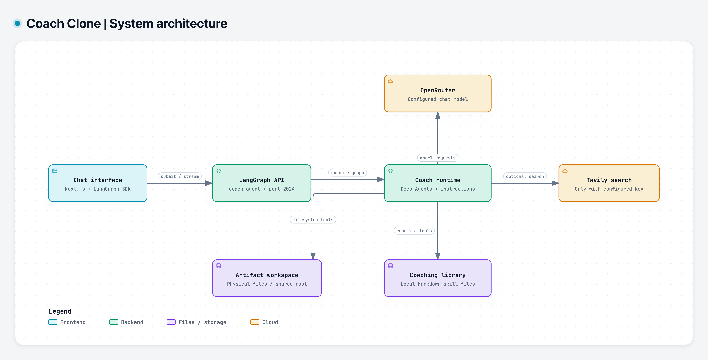
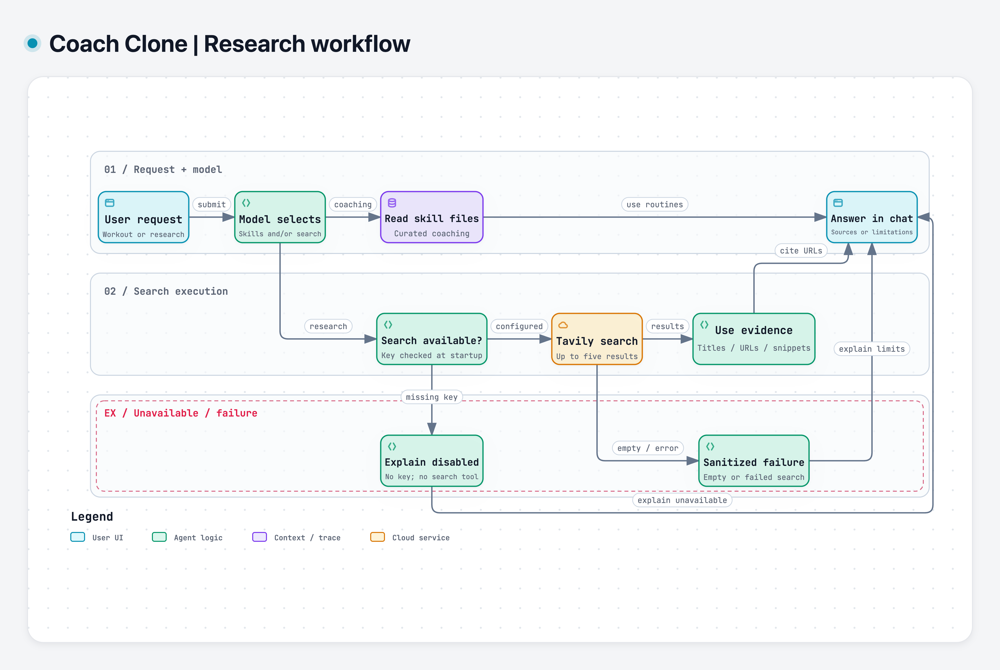
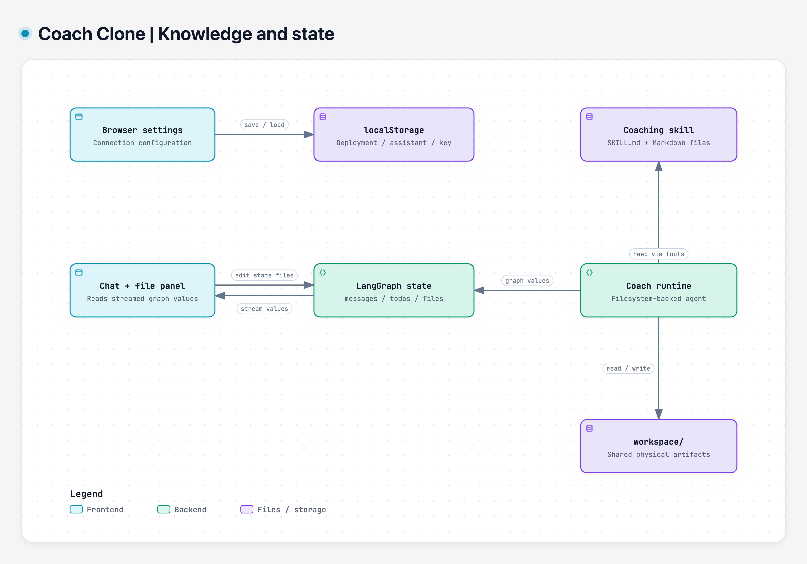

# Coach Clone: LangChain Deep Agent

A fitness-coaching assistant built with [LangChain Deep Agents](https://github.com/langchain-ai/deepagents) and LangGraph. It combines curated workout routines, coaching playbooks, and internet search in a conversational interface powered by an OpenRouter-hosted model.

The project includes a Python agent backend and a Next.js chat interface for local development.

## Technology stack

- **Agent framework:** LangChain Deep Agents, built on LangGraph
- **Backend:** Python 3.11+, LangChain integrations, and the LangGraph API server
- **Model provider:** OpenRouter through `langchain-openai`
- **Internet research:** Optional Tavily search through `langchain-tavily`
- **Web interface:** Next.js 16, React 19, TypeScript, and the LangGraph SDK
- **Python dependency management:** uv with a committed `uv.lock`
- **Frontend dependency management:** npm or Yarn (lockfiles are included)
- **Testing:** Python unittest/pytest harnesses and Next.js ESLint/build checks

## Capabilities

- **Curated workouts:** Ab, shoulder, upper-body, lower-body, and kettlebell routines with sets, reps, rest periods, and coaching notes.
- **Coaching playbooks:** Hypertrophy progression, fat-loss conditioning, mobility, and recovery guidance.
- **Skill-based retrieval:** Instructions direct the agent to consult local Markdown content when answering coaching questions.
- **Internet search:** Optional Tavily internet search for requested research, source-backed answers, and current information, including general topics.
- **Agent tooling:** Framework-provided planning, filesystem operations, and subagent capabilities.
- **Streaming chat:** Conversation history, tool-call displays, task tracking, and support for compatible interrupts.

The coach uses curated skills for workout programming and internet search when research is requested. There is no dedicated weather tool; current outdoor conditions require suitable search evidence.

## Architecture

### System architecture

The browser submits messages to the local LangGraph API, which runs the coach with an OpenRouter model, curated skills, optional Tavily search, and filesystem tools.



[Interactive diagram](docs/diagrams/system-architecture.html) · [SVG](docs/diagrams/system-architecture.svg)

### From a question to a researched answer

The model follows instructions to retrieve curated routines and/or search for evidence. Search availability is determined at startup. Missing configuration and provider failures lead to an explanation of the limitation; they do not trigger a fallback provider.



[Interactive diagram](docs/diagrams/research-workflow.html) · [SVG](docs/diagrams/research-workflow.svg)

This is a behavioral overview, not a deterministic routing graph. The model can combine skill retrieval with research and may take multiple tool steps before answering.

### Coaching knowledge and application state

The coaching library and generated workspace artifacts are physical files. The UI file panel reads and edits `state.files`; the application does not synchronize that field with the physical workspace.



[Interactive diagram](docs/diagrams/knowledge-and-state.html) · [SVG](docs/diagrams/knowledge-and-state.svg)

Diagrams were generated with Archify from the inspected working tree. See the [diagram guide and source evidence](docs/diagrams/README.md) for scope, editable definitions, and regeneration instructions. Download the HTML files and open them in a browser to explore the interactive versions.

### Component map

| Component | Location | Purpose |
| --- | --- | --- |
| Agent factory | `src/agent.py` | Assembles the model, tools, filesystem backend, skills, and system prompt |
| Model configuration | `src/config.py` | Loads environment settings and configures OpenRouter |
| Custom tools | `src/tools.py` | Configures optional Tavily search and sanitizes provider errors |
| Coaching skill | `skills/fitness-coach/` | Contains the skill guide, playbooks, and workout collections |
| Graph configuration | `langgraph.json` | Registers the `coach_agent` graph |
| Server launcher | `run_server.sh` | Starts LangGraph inside the project environment |
| Web interface | `deep-agents-ui/` | Provides the Next.js chat application |
| Smoke-test harness | `tests/test_coach.py` | Checks agent construction or runs example queries |

## Requirements

- Python 3.11 or later, below Python 4
- [uv](https://docs.astral.sh/uv/) for the Python environment and locked dependencies
- A Node.js version compatible with the bundled Next.js release, and npm
- An OpenRouter API key
- An optional Tavily API key

## Local setup

Run commands from the project root unless otherwise indicated.

### 1. Install Python dependencies

```bash
uv sync --locked
```

This creates the project `.venv` and installs dependencies, including the development tools needed to run LangGraph.

### 2. Configure the environment

Copy the example configuration, then replace the model API key in `.env`:

```bash
cp .env.example .env
```

```dotenv
OPENROUTER_API_KEY=your_openrouter_api_key

# Optional: override the configured default model.
OPENROUTER_MODEL=anthropic/claude-3.5-sonnet

# Optional: enable internet research; coaching works without this key.
TAVILY_API_KEY=your_tavily_api_key
```

| Variable | Required | Behavior |
| --- | --- | --- |
| `OPENROUTER_API_KEY` | Yes, for live requests | Authenticates model requests to OpenRouter |
| `OPENROUTER_MODEL` | No | Defaults to `anthropic/claude-3.5-sonnet`; choose a model available to your account that supports tool calling |
| `TAVILY_API_KEY` | No | Enables Tavily search; absent or placeholder keys disable search while preserving coaching |

Keep model-provider credentials in the backend `.env` file. The UI's optional LangSmith API key field is a separate deployment-access setting.

### 3. Start the backend

In the first terminal:

```bash
./run_server.sh
```

The server listens at `http://127.0.0.1:2024` and exposes the graph named `coach_agent`. The launcher uses `.venv/bin/langgraph` when available and falls back to `uv run langgraph`.

For direct invocation, use the isolated environment:

```bash
./.venv/bin/langgraph dev --host 127.0.0.1 --port 2024
```

### 4. Start the web interface

In a second terminal:

```bash
cd deep-agents-ui
npm ci
npm run dev
```

Open `http://localhost:3000`, or the address printed by Next.js, and enter:

| UI setting | Local value |
| --- | --- |
| Deployment URL | `http://127.0.0.1:2024` |
| Assistant ID | `coach_agent` |
| LangSmith API key | Leave blank for the default local server |

The UI saves connection settings in browser local storage.

## Example requests

- “Give me an upper-body workout using your curated routines.”
- “Explain your hypertrophy playbook and how double progression works.”
- “Build a kettlebell session focused on shoulders and abs.”
- “Search for exercise technique guidance for the Romanian deadlift and cite your sources.”
- “Research a topic outside fitness and summarize the sources you find.”

The coaching instructions request structured sessions with warmups, exercise tables, and cooldowns. Researched answers should cite supporting URLs and acknowledge missing evidence. Actual retrieval, tool use, and citation quality depend on the model's behavior.

## Coaching content

```text
skills/fitness-coach/
├── SKILL.md
├── playbooks/
│   ├── fat_loss_conditioning_playbook.md
│   ├── hypertrophy_playbook.md
│   └── mobility_recovery_playbook.md
└── workouts/
    ├── ab_workouts.md
    ├── kettlebell_workouts.md
    ├── lower_body_workouts.md
    ├── shoulder_workouts.md
    └── upper_body_workouts.md
```

To extend the coaching library:

1. Add or update Markdown files in the appropriate directory.
2. Document every playbook in `skills/fitness-coach/SKILL.md`.
3. Keep workouts structured with exercises, sets, reps, rest periods, and modifications.
4. Keep skill instructions aligned with the actual directory names.

## Verification

Run the existing harness with the project's Python interpreter:

```bash
./.venv/bin/python -m tests.test_coach
```

The default harness compiles the agent with search enabled and disabled using dummy credentials. It does not invoke the model or search provider, even when real keys are configured. Failures return a nonzero exit status.

Run deterministic tests covering configuration, native results, empty results, synchronous/asynchronous failures, and agent wiring:

```bash
./.venv/bin/python -m unittest tests.test_search -v
```

To explicitly run live verification:

```bash
./.venv/bin/python -m tests.test_coach --live
```

Live verification requires both provider keys, sends external requests, and may incur charges. It checks a research tool call and source-linked answer, followed by retrieval of the curated hypertrophy playbook. A passing run provides smoke evidence, not a guarantee of answer accuracy.

The frontend also provides static checks:

```bash
cd deep-agents-ui
npm run lint
npm run build
```

## Current limitations

| Area | Current behavior |
| --- | --- |
| Current information | Search evidence can be incomplete or stale; the agent must acknowledge when current conditions cannot be established |
| Filesystem access | `virtual_mode=False` allows paths outside `workspace/`, subject to process permissions; the workspace is not a sandbox |
| Artifact isolation | The backend uses one project-level workspace rather than separate user or thread directories |
| UI file panel | Displays graph-state files; no project-specific bridge synchronizes them with physical workspace files |
| Tool approvals | The UI supports compatible interrupts, but the coach factory does not configure mandatory tool approvals |
| Credentials | Optional UI deployment keys are stored in browser local storage |
| Verification | Offline tests verify integration behavior; live smoke checks do not replace source-quality review or browser testing |

## Troubleshooting

| Symptom | Check |
| --- | --- |
| Missing `OPENROUTER_API_KEY` error | Add the key to the root `.env` file and restart the backend |
| Model or authentication error | Verify the OpenRouter key and select a model available to your account |
| Missing LangGraph executable | Run `uv sync --locked`, then start the server with `./run_server.sh` |
| Global Python or protobuf conflicts | Use the launcher or `.venv/bin/langgraph` rather than a global installation |
| UI cannot connect | Confirm the backend is running and the UI uses the correct deployment URL and `coach_agent` ID |
| Search is unavailable | Set a valid `TAVILY_API_KEY` and restart the backend; blank/example keys disable search, and provider failures produce a sanitized error without fallback |
| Workspace artifacts are absent from the UI | The file panel reads graph state rather than listing the physical workspace |
